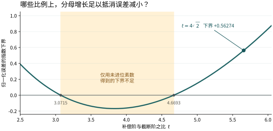

# 最佳实误差比例上的 BBP 补偿仍付不起分母代价

接续[两支 Yohaku 原生证明队的固定报告](https://github.com/epsilon-lain/yohaku/blob/7c4f272bb0c4b226610efddccd2e96dab3bc9e8e/research/pi-equivalence-native-2026-11-18/RANK-ODD-PRIMES-RESULTS.zh.md)。本篇是在该提交之后独立推导、复算的续研，原世界的任务、验收与回执均以固定报告为准。

**对于原报告指定的 Taylor 补偿，临界比例已经排除。** 设 $N$ 是原 BBP 截断阶，$M$ 是补偿多项式的次数，$X_{N,M}$ 是修正后的有理数，$Q_{N,M}$ 是它的正既约分母。对每个 $N\to\infty$、$M/N\to4\sqrt2$ 的序列，
$$
\liminf_{N\to\infty}\frac1N\log\!\left(Q_{N,M}^2\,|\pi-X_{N,M}|\right)
\ \ge D(4\sqrt2)>0.56274313749.
$$
其中 $D$ 的显式公式见下。这个比例使 $|\pi-X_{N,M}|$ 在该族的固定斜率中衰减最快。即便如此，光是奇数分母中已证保留的一部分素数，就足以使归一化误差指数增长。$\lfloor4\sqrt2 N\rfloor$、四舍五入以及任意 $o(N)$ 扰动都在量词内。

## 素数如何留下来

设 $L=8N+8$。对每个线性大小的奇素数 $p$，把有限 Taylor 系数按连续的 $p$ 项分组，并写 $L=up+\ell,M=vp+m$，其中 $0\le\ell,m<p$。当 $\ell+m+1<p$，最后一组的每个积分项乘以 $p$ 后都为零模 $p$。其余的整组可以求完，原和与补偿的联合余数只依赖 $u,v,p\bmod8$。例如 $u=v=1$ 时，按 $p\equiv1,3,5,7\pmod8$ 依次得到 $2,-4,2,-4$。这给出了补偿确实含有同一素数时，约分后仍然保留它的区间。[局部公式与 34 个区间组成的独立临界证书](BBP-COMPLETE-BLOCKS.zh.md)

对 $0<t\le8$ 定义
$$
s(t)=(8+t)\log(8+t)-8\log8-t\log t,\quad
E(t)=\log16+s(t)-t\log(1+\sqrt2).
$$
$E(t)$ 是实误差指数。把全部未进位区间求和，实际保留的这些奇素数的对数质量除以 $N$ **趋于** $G(t)=6+5t/4-s(t)$。总分母的指数因而至少是 $G(t)$，而归一化误差的下界指数是 $D(t)=2G(t)-E(t)$。在临界点，$G=3.8068659168\ldots$，只需超过的门槛是 $E/2=3.5254943480\ldots$。证明的无穷部分使用整块恒等式、对任意大 $u$ 的一致估计以及固定模数的素数定理。小 $u$ 剩下的 77 对参数可通过 308 个有限域计算一次证完。[总量证明与两根的有理区间](BBP-BLOCK-MASS.zh.md) · [固定模数素数定理](https://personal.math.ubc.ca/~gerg/papers/downloads/EBPAP.pdf)

## 当前能逐个排除哪些序列

令 $t_-$、$t_+$ 为 $D(t)=0$ 在 $(0,8]$ 的两个根。有 $3.07151<t_-<3.07152$，$4.66931<t_+<4.66932$。表中“逐阶”指对具有给定斜率的每个序列成立。

| 比例或参数 | 已证结论 |
| --- | --- |
| $M/N\to t\in[0,t_-)$ 或 $t\in(t_+,\infty)$ | 逐阶归一化误差指数发散。$t\ge8$ 用另外 64 个斜率区间的有理证书及高阶实余项。 |
| $M/N\to\infty$ | 绝对误差本身增长，且 $M^{-1}\log|\pi-X_{N,M}|\to\log(1+\sqrt2)$。 |
| $t\in[t_-,t_+]$ | 一般的单阶下界仍待证。在每组从奇数阶开始的连续四阶中，第二小的归一化误差下界指数至少为 $(t/2)\log(1+\sqrt2)$。 |
| $N=2^h-1,\ M=4N,\ h\to\infty$ | 精确二进赋值 $v_2(Q_{N,M})=4N+1$。此无限子族在中间比例 $t=4$ 的归一化误差下界指数大于 $5.38$。 |

[较高斜率与两个边界](BBP-HIGH-SLOPES.zh.md) · [相邻阶的精确分母、间隔和二进子族](BBP-ADJACENT.zh.md)

中间缺口可以精确计量。在 $M/N\to4$ 时，记 $C_{N,M}$ 为最终分母里确实保留的、满足进位条件的奇素数的对数和，每个只计一次。要建立整个斜率上的**严格正指数**，等价于证明
$$
\liminf_{N\to\infty}
\frac{(\log2) v_2(Q_{N,M})+C_{N,M}}{N}
> -D(4)/2=0.0808022\ldots .
$$
因此可以逐个核对两种贡献，特别要搜寻二者是否可能同时很小。若下极限恰等于门槛，指数比较不足以决定归一化误差是否仍缓慢发散。任何即使在此特殊构造中取得的逐阶下界，都仍与全体有理数的下界有量词差距。

## 另一条线上的真实秩

A 队的模型中，选取三个共线插值中心。原六阶方阵非零时，匹配、逐组独立和两侧真实共同基的最低费用仍可严格不同，依次精确为 $15\lambda,4+10\lambda,4+11\lambda$，其中 $\lambda=(\log2)/2$。在另一组明确权重下，还可用两条 Hermite 插值曲线证明，任意高度 $H$ 的平移矩阵 $U$ 中，费用小于 $30H/59$ 的整个前缀都线性无关。这表明删除原计数公式的适用条件会在完整指标集上漏算 $\Omega(H^3)$ 个独立方向。原行列式还需要同一组选列同时通过 $C$ 一侧的秩约束，以及完整的费用比较。[真实秩的证明和有限证书](RANK-FOLLOWUP.zh.md)

## 复算与方法经验

所有验证脚本均用 Python 3 标准库。以下命令在本目录分别执行。

| 命令 | 主要独立核对 |
| --- | --- |
| `python3 verify_bbp_complete_blocks.py` | 二次数域的有理提升，对照原始阶乘的模素数单位部分，含 $N=320,M=1810$ 的 187 个旧奇素数。 |
| `python3 verify_bbp_block_mass.py` | 用另一分裂素数核对 77 对参数，根的符号、临界点与中间缺口由有理上下界认证。 |
| `python3 verify_bbp_high_slopes.py` | 64 个连续斜率区间的最小质量，另一辅助素域逐格与有理数计算比对。 |
| `python3 verify_bbp_adjacent.py`、`python3 verify_bbp_short_gaps.py` | 积分的相邻差与短间隔差、Pell 因子及其在有限域的乘法阶。 |
| `python3 verify_bbp_dyadic_slice.py` | 4,352 个直接约分的有限分数，对照所证单阶二进结论。 |
| `python3 verify_rank_cuts.py` | 原矩阵的非零子式、两侧共同基费用、三处 Hermite 多项式次数以及有限秩。 |

这次改变结论的做法是回到原始有限积分，按一个素数把**所有项一起**求余数。此前 $p>L$ 的新素数区间依赖难控的不完全二项和；旧素数里存在能把和做完的区间。对余量求出确切总长，还能看出这条证明在哪些斜率会停下。对应的全局问题仍是 $\inf_{q\ge1}q\lVert q\pi\rVert$ 是否严格为正，本轮没有判定。[无理性指数与临界常数的区别](https://github.com/openai/math/blob/4eaee87548250b2682affda7d05d947c05554bae/preprints/The-irrationality-exponent-of-pi-is-2-September-24-2026/build/main.tex)
