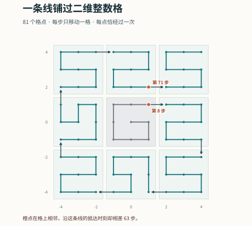

# 从一个自然数到整个整数平面的局部几何

设时间从零开始，每一拍只许向东、西、南或北走一格。下面给出一条从原点开始、恰好访问每个格点一次的路线 $F:\mathbb N_0\to\mathbb Z^2$。若两时刻相隔 $d\ge1$ 拍，两位置在任一坐标上的差都不超过 $6\sqrt d$。因此时钟连续走过的每一小段，在空间里都有相应的大小上界。

构造借用 Peano 曲线的三等分思想。经典有限格点曲线、不同的递归遍历及空间局部性见 Haverkort 的 [Sixteen space-filling curves and traversals](https://arxiv.org/abs/1711.04473)。下文直接给出本笔记使用的单向全平面拼法、端点与常数，并不主张这一类构造的文献优先权。

## 从三个可逐边核对的模板开始

用两字母方向表示小方框的角，用一个或两个方向字母表示它在九宫格的位置，C 为中心。每一格写作“位置，入口，出口”。例如 E NW SE 表示东边的小方框，从其西北角走到东南角。有限填法分两种，D 从西南到东北，A 从西南到东南。任意同类角对都可以通过旋转或反射得到。边长从 1 开始，两种填法当时都只有一个点。

| 顺序 | D · 对角进出 | A · 相邻的角进出 | 从已填中心向外添一圈 |
|---:|:---|:---|:---|
| 1 | SW SW NE | SW SW NE | E NW SE |
| 2 | S NW SE | W SE NW | SE NE SW |
| 3 | SE SW NE | NW SW NE | S SE SW |
| 4 | E SE NW | N NW NE | SW SE NW |
| 5 | C NE SW | NE NW SE | W SW NW |
| 6 | W SE NW | E NE SW | NW SW NE |
| 7 | NW SW NE | C SE SW | N NW SE |
| 8 | N NW SE | S NW NE | NE SW NE |
| 9 | NE SW NE | SE NW SE | |

前两列各自从九个边长 $s$ 的小方框得到一个边长 $3s$ 的填法。每个出口与下一个入口在公共边上面对面，恰相差一个单位步。九个小框不相交，因此端点和全覆盖性都由归纳得到。

令 $B_k=[-r_k,r_k]^2\cap\mathbb Z^2$，其中 $r_k=(3^k-1)/2$。从 $B_0$ 的原点开始。若已经填满 $B_k$，且停在其东北角，则第三列从东边方框的西北角开始，恰好覆盖 $B_{k+1}\setminus B_k$ 的八个小框，最后停在 $B_{k+1}$ 的东北角。因此在时刻 $9^k-1$ 访问过的恰好是整个 $B_k$。每步都延长已有路线，所有 $B_k$ 的并为整个整数平面，遂得到自然数时间上的无遗漏、无重访单位步路线。

## 一段时间能走出多远

任取 $k\ge0$。对每个 $j\ge0$，从 $j9^k$ 到 $(j+1)9^k-1$ 的整块时刻恰好填满一个边长 $3^k$ 的格点方框。第一块是 $B_k$，此后在各级更大的 D、A 模板中，递归展开到边长 $3^k$ 即得对应小方框。相邻时间块的方框共边，因为块间只有一个单位步，且各个小框在同一格网上对齐。

给定 $d=t-s\ge1$，取使 $d\le9^k$ 的最小 $k\ge0$。这段时间至多跨两个相邻块，因此
$$
\|F(t)-F(s)\|_\infty\le 2\cdot3^k-1\le6\sqrt d .
$$
在所有单射路线里，指数 $1/2$ 不能减小。若有 $a<1/2$ 和固定 $C$ 使前 $d+1$ 个不同点都落在半径 $Cd^a$ 的方框内，框内可用格点只有 $O(d^{2a})=o(d)$ 个，与单射性矛盾。这里未优化系数 6。

反方向的“邻近”有明确的代价。对于任何从自然数到全平面的双射，一个边长 $h\ge2$ 的方框里，最大、最小时刻至少相差 $h^2-1$。对应格点可在方框内以至多 $2(h-1)$ 个单位步连接，所以至少有一对相邻格点的时间差达到 $(h+1)/2$。在本构造中甚至能写出精确的二次差。取 $s=3^k, r=(s-1)/2$，格点 $(r,r)$ 是旧框终点，时刻为 $s^2-1$。其北邻 $(r,r+1)$ 是新一圈北边方框的东南角，时刻为 $8s^2-1$。两点只差一格，时间相差 $7s^2$。

## 读出分数与抵达速度

将格点写作 $(q,p)$。只在 $q>0, \gcd(q,|p|)=1$ 时读出 $p/q$，每个有理数就恰输出一次，包括零。两个输出之间可能有若干个只走过而不读数的点。平方根界计算的是每一次真实移动。删除过路点会改变这个时钟。

对任何方向，例如 $p=\lfloor\pi q+1/2\rfloor$，有 $q\le\|F(t)-F(0)\|_\infty\le6\sqrt t$，故抵达第 $q$ 列至少要 $q^2/36$ 拍。反过来，整个对应高度的方框在高度平方量级的时间内填完，固定斜率的标记点也会在 $O(q^2)$ 时间内命中。这确立“每一段路都保持平方根局部性”和“一条固定方向得到线性抵达时间”之间的冲突。同轮的方框加细带构造在单位步和自避条件下同时做到了全局二次、定向线性。由本界，它的某些行程必然超出任何给定的平方根位移上界。以上并未判定归一化逼近误差 $q\|q\pi\|$ 的下确界。

[格点序列及覆盖核验](verify_peano_clock.py) · [按时刻直接找坐标，按坐标反查时刻](peano_random_access.py)

给定格点，先用其到原点的最大坐标距离找到首次覆盖它的方框，再根据它属于哪个小框逐级读取九进制编号。逆运算用编号逐级选小框。两者的模板选择次数对坐标高度或时间均为对数量级。位运算成本另计。脚本在边长 243 的方框中核对了 59,049 个不同格点、所有单位步、每一级的所有整块访问以及 $17,983$ 个最简分数输出。双向直接编号与逐点形成的整条序列完全相符。
