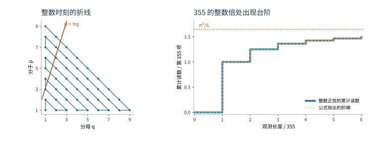

# 一条连续折线怎样把 π 的反证变成整段波形的问题？

研究路线是先用单个实数时刻直接写出全覆盖折线，再把反设转成整数正弦波上可观察的现象，最后检验已知的无理性指数能控制这种现象到什么程度。本文用半径随分母收缩的量 $q|q\pi-p|$ 衡量逼近质量。以下判据与条件轮廓均有证明。圆周率是否坏逼近仍然开放。

[连续折线的直接公式](PI-CONTINUOUS-CLOCK.zh.md) · [整数正弦波的判据及证书](PI-SINE-IMPULSES.zh.md) · [高斯平滑后的连续尺度公式](PI-THETA-WAVE.zh.md)

## 整数时刻与实数交点

在正整数格中沿 $p+q=N$ 交替行走，相邻两行用一个单位步相接。令 $t\ge0$，用 $k=\lfloor(\sqrt{8t+1}-1)/2\rfloor$、$s=t-k(k+1)/2$ 找到这一行和行内的位置。取 $u=1+s,\ w=1+\max(k-s,0)$。偶数 $k$ 取 $(P,Q)=(u,w)$，奇数 $k$ 交换两坐标。于是 $F(t)=P(t)/Q(t)$ 连续，给定任意一个时刻即可直接求值。正整数对在整数时刻各出现一次。若要求有符号的全部有理数，只需令 $t\ge1$ 时取原曲线 $\Gamma(t-1)$，$t\le-1$ 时将 $\Gamma(-t-1)$ 的第一坐标取负，$|t|\le1$ 时取 $(t,1)$。两端相接，且整数时刻的分数包含零与全部负有理数。

连续像包含中间的无理数。对 $N\ge5$，第 $N$ 行与 $P=\pi Q$ 总有实数交点。设该交点的时刻为 $t_N$，则它离最近整数时刻的距离恰是 $\|N/(1+\pi)\|$，这里 $\|x\|$ 表示 $x$ 到最近整数的距离。连续像与水平线相交本身对每个正无理目标都会发生。把时钟改成 $t-\sin(2\pi t)/(2\pi)$ 甚至会把极小的交点时间偏差 $d$ 变成常数乘 $d^{1/3}$，而每一个有理样本、分母和算术误差依旧相同。对角线列举有理数是已有构造，参见 Gibbons、Lester 与 Bird 的论文第 1 节。[Enumerating the Rationals](https://citeseerx.ist.psu.edu/document?doi=6b475421a833842e4014ebeeaa4f4ec7c3dcc424&repid=rep1&type=pdf)

## 用整段正弦波检验反设

因为 $\sin(q\pi)=0$，可以改为在整数分子 $n$ 处读取 $w_n=1/\sin^2 n$，角度单位为弧度。记 $S(M)=\sum_{k=1}^M w_k$，$S(0)=0$。若 $n/m$ 异常接近 $\pi$，$n$ 就异常接近波的零点 $\pi m$。同一 $n$ 下，到最近零点的距离由 $m$ 为最靠近 $n/\pi$ 的整数给出。取倒数将归一化误差乘上趋于 1 的因子。

设反面假设成立。取互素 $m,n$，令 $\epsilon=n|n/\pi-m|\to0$，则 $n\to\infty$。此前的 $n-1$ 个相位接近完整的有理网格，只有第 $n$ 个点极接近零点。精确的网格求和给出

$$
S(n-1)=\frac{n^2-1}{3}\,(1+O(\epsilon)),\qquad
\frac{w_n}{S(n-1)}\sim\frac{3}{\pi^2\epsilon^2}.
$$

反过来，若有一致的正下界 $n\|n/\pi\|\ge c$，则 $|\sin n|\ge2c/n$。狄利克雷抽屉原理给出 $S(n-1)\ge n^2/\pi^2$。因此 $w_n/S(n-1)\le\pi^2/(4c^2)$。两方向合起来，**圆周率坏逼近等价于单个峰与此前总和之比有统一上界**。具体证明与公因数的处理见[正弦判据](PI-SINE-IMPULSES.zh.md)。

## 反设给出整条阶梯的形状

固定实数 $0<\rho<1$。在上述任一列互素见证上，对所有实数 $0\le x\le\rho/\epsilon$，一致地有

$$
\frac{S(\lfloor nx\rfloor)}{w_n}
= \sum_{1\le j\le \lfloor x\rfloor}\frac1{j^2}
  + O_\rho(\epsilon+n^{-2}).
$$

证明分两步。先看 $k=jn$。令 $u=\pi\epsilon/n$。因 $ju\le\pi\rho/n$，有 $w_{jn}/w_n=(\sin u/\sin(ju))^2=j^{-2}(1+O_\rho(n^{-2}))$，在所需范围一致成立。再看非整倍数。若 $km\bmod n$ 离 $n\mathbb Z$ 的距离为 $d\ge1$，则 $\|k/\pi\|\ge(d-\rho)/n\ge(1-\rho)d/n$。每个长度为 $n$ 的分块里，每个 $d$ 至多出现两次。因此每块的非整倍数总和至多为 $C_\rho n^2\sum_{d\ge1}d^{-2}$。共至多 $1+\rho/\epsilon$ 块，乘 $1/w_n=\sin^2 n\le(\pi\epsilon/n)^2$ 即得总误差 $O_\rho(\epsilon)$。

例如取 $x=\lfloor 1/(2\epsilon)\rfloor$，窗口长度是 $n$ 的一个趋于无穷的倍数。单项 $w_n$ 在全窗口中所占比例趋于 $6/\pi^2$。对 $B=\lfloor\rho/\epsilon\rfloor$ 还可以把末端的误差算到一阶，即 $S(Bn)/w_n=\pi^2/6-\pi\epsilon\cot(\pi\rho)+O_\rho(\epsilon^2)$。在半窗口 $\rho=1/2$，一阶项恰好为零。逐块的平移与求和证明见[长窗口公式](PI-SINE-IMPULSES.zh.md)。在 $n=355$ 处可以直接检验这一有限现象。图中的前六个周期展示每个倍数贡献的阶梯，数值曲线仅作示意。

## 把反证推到哪一步

取 $D_j=S(2^{j+1})/S(2^j)$，其中 $j$ 为非负整数。这是把观察区间扩大一倍，整段能量随之放大的倍数。以下两个结论分别控制最大值与几何平均。

$$
\pi\text{ 是坏逼近数}\iff \sup_{j\ge0} D_j<\infty,
\qquad
\lim_{J\to\infty}\left(\prod_{j=0}^{J-1}D_j\right)^{1/J}=4 .
$$

证明第一式。记 $\alpha=1/\pi$，$\Delta_M=\min_{1\le r\le M}\|r\alpha\|$。圆周上的 $0,\alpha,\ldots,M\alpha$ 两两间距至少为 $\Delta_M$。在原点的顺时针与逆时针两个半圆中分别排序，每一侧第 $i$ 个点离原点的距离至少为 $i\Delta_M$。由 $|\sin(\pi x)|\ge2\|x\|$ 及抽屉原理，

$$
\frac{(M+1)^2}{\pi^2}\le S(M)\le
\frac{1}{2\Delta_M^2}\sum_{i=1}^\infty i^{-2}.
$$

坏逼近时 $\Delta_M\ge c/M$，故 $S(M)$ 在两个固定正倍数的 $M^2$ 之间，每个 $D_j$ 有统一上界。反过来，若 $2^j<n\le2^{j+1}$，则 $w_n/S(n-1)\le S(2^{j+1})/S(2^j)=D_j$。因此所有 $D_j$ 有界就由正弦判据推出坏逼近。

证明第二式。已知 $\mu(\pi)=2$。取倒数后，对任意 $\eta>0$，均有 $\|r/\pi\|\ge c_\eta r^{-1-\eta}$，常数吸收有限个小分母。代回上式得 $S(M)=M^{2+o(1)}$。各个 $D_j$ 的乘积恰为 $S(2^J)/S(1)$，取 $J$ 次方根得到 $4$。这也给出对每个固定 $K>1$ 的定量限制：

$$
\limsup_{J\to\infty}\frac{\#\{0\le j<J:D_j\ge K\}}{J}
\le\min\!\left(1,\frac{\log 4}{\log K}\right).
$$

反证现在遇到一个明确的障碍。均值允许极少数区间大幅增长，而坏逼近要求所有区间的增长倍数有界。这个缺口即使在同类正弦波上也会出现。一个对照是 $\alpha=[0;1,2,3,\ldots]$，把 $w_n$ 换成 $1/\sin^2(\pi n\alpha)$。其第 $k+1$ 个部分商趋于无穷，故 $q_k\|q_k\alpha\|\to0$。另一方面 $q_k$ 至少按斐波那契数增长，$q_{k+1}\le(k+2)q_k$。由收敛分数的第二类最佳逼近性，$q_k\le r<q_{k+1}$ 时 $\|r\alpha\|\ge\|q_k\alpha\|>1/(q_{k+1}+q_k)$。这给出 $\|r\alpha\|\gg_\eta r^{-1-\eta}$ 对每个 $\eta>0$ 成立，故同样有几何平均 $4$，同时 $\sup_jD_j=\infty$。要完成针对 $\pi$ 的反证，目前缺的是在固定相位 $\sin n$ 下排除无界的稀疏峰。[OpenAI 原文中的指数定理、量词与推论](https://github.com/openai/math/blob/main/preprints/The-irrationality-exponent-of-pi-is-2-September-24-2026/build/main.tex)

运行 `python verify_pi_continuous_wave.py` 可重算有限证书。运行 `python verify_pi_continuous_wave.py --long` 可另验 $355/113$ 对应的 $51\,830$ 项窗口。
