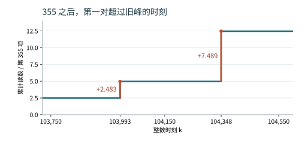

# 越过第一座波峰，整条正弦波在另一相位上重现

上次证明了，若 π 不是坏逼近数，一座足够强的峰会在整数倍处产生可预报的阶梯。[上一轮的证明](PI-CONTINUOUS-WAVE.zh.md)

原来的近似适用于下一组格点接近直线以前。这一页沿用同一条整数时钟和同一个正弦读数，计算越过这些格点以后，整条累计曲线的形状。

## 从一个分数直接算出下一条波

对实无理数 $\alpha$ 和非负整数 $L$，记
$$
S_\alpha(L)=\sum_{k=1}^L\frac1{\sin^2(\pi k\alpha)}.
$$

取 $\alpha=1/\pi$ 时读数就是普通的整数弧度正弦。设 $m/n$ 既约、$n\ge2$，写
$$
\epsilon=n|n\alpha-m|,\qquad \sigma=\operatorname{sgn}(n\alpha-m).
$$
取唯一 $1\le r<n$ 满足 $mr\equiv-\sigma\pmod n$。令 $\theta=\{1/\epsilon-r/n\}$，其中花括号表示小数部分。对任意整数 $D\ge0$，直接算 $B_D=\lfloor(D+1/2)/\epsilon\rfloor$。则累计读数满足以下统一绝对误差界。

$$
\left|\frac{\epsilon^2}{n^2} S_\alpha(n B_D)-\frac16-S_\theta(D)\right|
\le 3\epsilon^2\qquad(0<\epsilon\le 1/8).
\tag{1}
$$

这里 $D$ 没有上限，右边与 $D$ 无关。相邻两式相减，可得第 $D$ 个区间总量的误差界。

$$
\left|\frac{\epsilon^2}{n^2}\big[S_\alpha(nB_D)-S_\alpha(nB_{D-1})\big]
-\frac1{\sin^2(\pi D\theta)}\right|\le 6\epsilon^2\qquad(D\ge1).
\tag{2}
$$

对于 $355/113$，在倒数坐标中 $m=113,n=355,\sigma=+1,r=333$。这给出 $\epsilon\approx0.00340631221938$、$\theta\approx0.63459101439547$。第一个区间从 $51\,831$ 至 $156\,200$，第二个从 $156\,201$ 至 $260\,215$。式 (2) 对这两个区间及此后的每个区间，绝对误差都小于 $0.00006962$。比较带有 $\epsilon^2/n^2$ 的归一化。相位与截点在定理中一律取精确值，任意大 $D$ 不能直接代入上面列出的相位近似小数。

在第一条相邻格线上，超过旧峰的两个时刻为 $103993$ 和 $104348$。它们都没有刷新归一化的有理逼近纪录。

## 成立的原因是带符号的边界误差相消

给定正整数 $B$，记 $A=B\epsilon$，$D=\lfloor A\rfloor$。由于 $\alpha$ 无理，$A$ 不是整数。对每个整数 $d$，取 $u_d$ 为 $dr/n$ 模 1 在 $(0,1]$ 的代表，特别地 $u_0=1$。经典部分分式展开给出精确恒等式

$$
(\pi\epsilon/n)^2 S_\alpha(Bn)
=\sum_{d\in\mathbb Z}\sum_{j=0}^{B-1}(j+u_d-d/\epsilon)^{-2}.
\tag{3}
$$

实际上，对每个 $k$ 展开 $\csc^2(\pi k\alpha)=\pi^{-2}\sum_{a\in\mathbb Z}(k\alpha-a)^{-2}$，设置 $d=\sigma(an-km)$。于是 $k\equiv dr\pmod n$，且 $k\alpha-a=(\sigma\epsilon/n)(k/n-d/\epsilon)$。非负项允许交换求和次序。这一行列式坐标 $d$ 正是把点分配到不同平行格线的整数。[NIST DLMF，公式 4.22.3–4.22.4](https://dlmf.nist.gov/4.22)

若 $1\le d\le D$，点 $a=d/\epsilon$ 位于 $(0,B)$ 内，先把第 $d$ 行补成整行。因 $d/\epsilon-u_d\equiv d\theta\pmod1$，补齐的一行精确等于 $\pi^2\csc^2(\pi d\theta)$。这些内行剩下两条尾部的负值，外行保留区间 $[0,B]$ 内的全部项。对每个 $d\ne0$，把剩余部分以积分替代。内行取外部积分的负值，外行取内部积分，两种结果均为
$$
I_d=\epsilon\left(\frac1{d-A}-\frac1d\right).
$$
函数 $(x-a)^{-2}$ 在所取的每一段上单调。每个单位区间里的样本与该格积分之差至多为函数在该格的变化量。相加后，第 $d$ 行的绝对误差至多为
$$
\epsilon^2\left(d^{-2}+(d-A)^{-2}\right).
$$
第零行是 $\sum_{j=1}^B j^{-2}=\pi^2/6-1/B+e_0$，其中 $0\le e_0\le1/B^2$，由积分夹逼得到。

对 $d\ne0$ 求和，$\sum I_d=\epsilon[-\pi\cot(\pi A)+1/A]$。其中 $\epsilon/A$ 恰抵消第零行的 $-1/B$。误差取绝对值求和，得到对每个 $B\ge1$ 均成立的估计
$$
\left|\frac{\epsilon^2}{n^2}S_\alpha(Bn)-\frac16-S_\theta(D)
       +\frac\epsilon\pi\cot(\pi A)\right|
\le\epsilon^2\left(\frac13+\csc^2(\pi A)\right).
\tag{4}
$$
取 $B=B_D$，则 $D+1/2-\epsilon<A\le D+1/2$。余切项绝对值至多 $\epsilon^2\sec^2(\pi/8)$，因 $\tan v\le v\sec^2(\pi/8)$ 在 $0\le v\le\pi/8$ 成立。于是式 (4) 的总误差至多 $[1/3+2\sec^2(\pi/8)]\epsilon^2<3\epsilon^2$，即式 (1)，包括 $D=0$。这一常数来自对带符号的积分先求和；逐行对积分取绝对值会丢掉相消。

## 反证的限制也可以定量证明

上一座峰能不能决定下一座峰的最高读数？固定 $m,n,r,\sigma$，固定正整数 $J$，允许斜率改变。用单个参数 $z\in(0,1)$ 建立一族斜率
$$
\epsilon_z=\frac1{J+r/n+z},\qquad
\alpha_z=\frac mn+\frac{\sigma\epsilon_z}{n^2}.
$$
在这族上，式 (1) 的下一相位恰为 $z$。令 $s=(mr+\sigma)/n$，则
$$
\alpha_z=\frac{m(J+z)+s}{n(J+z)+r},\qquad mr-ns=-\sigma.
$$
对真实的 $\pi$，相位当然已经固定。

写 $w_k(z)=\csc^2(\pi k\alpha_z)$。对任意 $z,z'\in(0,1)$ 有
$$
\left|\log\frac{w_k(z)}{w_k(z')}\right|\le\frac{2|z-z'|}{J}
\qquad(1\le k\le Jn/2).
\tag{5}
$$
证明时用 $\pi|\cot(\pi x)|\le1/\|x\|$，$\|x\|$ 为到最近整数的距离。若 $n\nmid k$，$km/n$ 离整数至少 $1/n$，漂移 $k\epsilon_z/n^2\le1/(2n)$。由 $|\partial_z\alpha_z|=\epsilon_z^2/n^2$ 得 $|\partial_z\log w_k|\le 2/J$。若 $k=jn$，离最近整数的距离等于 $j\epsilon_z/n$，同一导数绝对值至多 $2\epsilon_z\le 2/J$。对 $z$ 积分即得。

而在所有这些曲线共用的时刻 $k_*=Jn+r$，
$$
w_{k_*}(z)=\csc^2(\pi\epsilon_z z/n).
\tag{6}
$$
这是行列式 $d=1$ 的精确读数，令 $z$ 经无理数趋于零即可使它任意大。于是可以让两条波的前 $\lfloor Jn/2\rfloor$ 个读数**逐项、相对地**任意接近，后面同一时刻的读数之比仍然可以任意大。这个反例检验的是从半窗口的近似波形推出下一峰的尝试。若使用圆周率独有的恒等式限制相位，仍有继续研究的余地。

## 对圆周率的结论

式 (1) 和 (2) 给出一个可在任意远处使用的公式。原问题仍要求 $\inf_{q\ge1}q\|q\pi\|>0$。改变到 $\theta$ 是一个整系数、行列式绝对值为 1 的分式线性变换（再加整数）。在逼近序列上它保留归一化误差趋于零这一性质。因此固定一个已知的好分数并完成上述放大，还不能推出统一正下界。需要针对 $1/\pi$ 的具体相位控制所有后续共振，或者给出一个产生归一化误差趋零的无限序列。

[有限证书与下一峰](PI-SINE-TRANSITION-CERTIFICATE.zh.md) · [共振处的单点和连续时刻公式](PI-SINE-COLLISION.zh.md) · [倍增区间中的峰值与后继区间](PI-DYADIC-SPIKE.zh.md) · [对固定有理公式的限制](PI-RATIONAL-MAP-LIMIT.zh.md)
