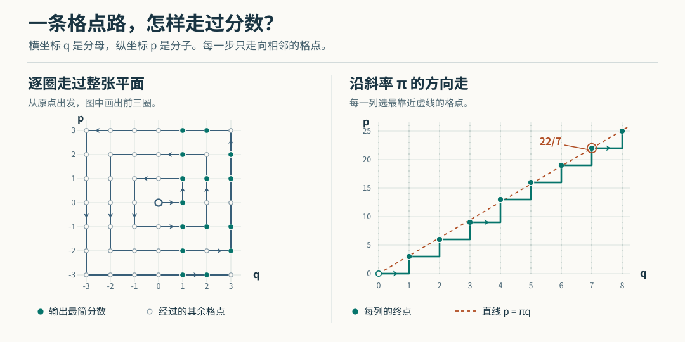

# 用一个整数步数走遍分数

横坐标是分母 \(q\)，纵坐标是分子 \(p\)。时钟 \(t=0,1,\dots\) 每增加一，脚下的位置只许向东、西、南、北移动一格。允许在途中经过不输出分数的点。先构造一条遍历全格的线，再问一条线能以多快的速度找到指定斜率的点。

这是对 10 月 31 日笔记里“相邻事件的邻近性”的接续。原来的第一条路线沿 \(p+q\) 的对角线编号，第二条路线在各分母层找到最近整数，两者的层切换都允许跳跃。[对角编号与原问题](https://github.com/epsilon-lain/lain-s-note/blob/08455fb3692d0d121171d7a56067aabfc068b08f/research/base-transport-2026-10-31/ONE_PARAMETER_RATIONAL_CLOCK.md) · [逐层扫描与最近整数](https://github.com/epsilon-lain/lain-s-note/blob/08455fb3692d0d121171d7a56067aabfc068b08f/research/rational-single-clock-scan-2026-10-31/README.md)

同分支的[有理路径接力](NEXT-RATIONAL-WALK.zh.md)已记录螺旋、左右树和稀疏候选的 Farey 跳步枚举。以下给出实际格步的全覆盖证明、同一条路线的两种抵达时限，以及最短覆盖费用。

## 一条线和它的输出

从 \((0,0)\) 出发，按东、北、西、南循环，连续各段长度取 \(1,1,2,2,3,3,4,4,\ldots\)。记开始时刻为 0。归纳可得，绕完半径 \(H\) 的方框时，脚在 \((H,-H)\)，已走 \((2H+1)^2-1\) 步。归纳步从该处向东一格，到下一方框的右边，依次沿右、上、左、下四边走至 \((H+1,-H-1)\)。每个新边界点恰经过一次。这给出了整个 \(\mathbb Z^2\) 的一条不重复的单位步路径。

在 \(q>0\) 且 \(\gcd(q,|p|)=1\) 时输出 \(p/q\)。每个有理数有唯一这样的代表，因此正数、负数和零都恰输出一次，零在 \((1,0)\) 输出。若要求左、右是算术操作，也已有 Calkin–Wilf 树，从 \(a/b\) 可走到 \(a/(a+b)\) 或 \((a+b)/b\)。树中一步在画出的方格上可以很长。步数比较采用上面的单位格定义。[Calkin 与 Wilf 的原文](https://www2.math.upenn.edu/~wilf/website/recounting.pdf)

删去重复分数后的点叫原始格点，从原点看，它们各自是相应射线上第一个非零格点。在正方形 \(1\le p,q\le H\) 内，其个数为
\[
V(H)=\sum_{d=1}^H\mu(d)\lfloor H/d\rfloor^2
=\frac6{\pi^2}H^2+O(H\log(2H)).
\]
这里 \(\mu\) 是莫比乌斯函数，\(\sum_{d\mid n}\mu(d)\) 只在 \(n=1\) 时为 1。把每个格点的互素指示量这样展开就得到第一式。展开平方取整误差并延长 \(\sum\mu(d)/d^2\) 得到第二式。若 \(N\) 表示要输出的不同分数个数，沿螺旋用 \(O(N)\) 格步即可输出前 \(N\) 个，因整个方框里符合输出条件的点占渐近正比例。若 \(N\) 表示方框边长，同一方框的全部分数需要 \(\Theta(N^2)\) 步。只限制 \(q\le N\) 而让 \(p\) 任意，连候选集合也仍是无限的。[格点可见性与密度定理](https://www.math.ucsd.edu/~jmckerna/Teaching/17-18/Winter/104B/l_17.pdf)

路过的格点有实际作用。比如 \(15/4\) 的位置 \((4,15)\) 本身互素，四邻 \((3,15),(5,15),(4,14),(4,16)\) 的最大公因数依次为 \(3,5,2,4\)。只许踩在最简代表上的单位步行无法走遍全部分数。一条更强的限制及绕过这些点的实际步数见[最短路线的界](PRIMITIVE-ROUTE-COST.zh.md)。

## 沿一个方向线性地检查每个分母

取 \(p_0=0\)，对 \(q\ge1\) 取 \(p_q=\lfloor q\pi+1/2\rfloor\)。无理性保证最近整数唯一。每次先向右一格，再向上走到 \(p_q\)。因为 \(3<\pi<4\)，相邻高度差为 3 或 4。到达第 \(N\) 个标记点恰好用
\[
L(N)=N+p_N=(1+\pi)N+O(1)
\]
步，这是两端点的曼哈顿距离，任何单位步路径都无法更短。从原点到 \((7,22)\) 只需 29 步，到 \((113,355)\) 只需 468 步。两处对应的是同一条路径的两个时刻。

第 \(q\) 列的其他分子不会比标记点更近。因此就检验坏逼近性而言，这条细线保留了该列的全部必要信息。精确地，
\[
\min_{p\in\mathbb Z}q^2|\pi-p/q|=q\,|q\pi-p_q|.
\]
坏逼近性要求这些数在所有 \(q\) 上有共同正下界。路径长度定理给出抵达时间，下确界究竟为零还是严格为正，仍然开放。相同构造适用于其他正斜率，以统一的半整数取整约定处理有理斜率；每步上升数改取该斜率的整数下取整或上取整。

## 同一只钟兼顾全体分数与一条优先方向

允许走回已经走过的格点。对 \(h=1,2,4,8,\ldots\) 依次执行两个行程，每阶段从原点出发。

1. 走到 \((1,-h)\)，水平蛇形逐行扫遍 \(1\le q\le h,-h\le p\le h\)，在 \((h,h)\) 结束并回原点。两个接头分别用 \(1+h\) 和 \(2h\) 步，扫行用 \(h(2h+1)-1\) 步，合计 \(2h^2+4h\) 步。
2. 沿前节阶梯走到 \((h^2,p_{h^2})\)，原路返回。来回用 \(2(h^2+p_{h^2})\) 步。

所以单阶段共 \(4h^2+4h+2p_{h^2}=O(h^2)\) 步。前面所有阶段的总时长也是 \(O(h^2)\)，由等比数列求和可得。若指定方框高度 \(H\)，选首个 \(h\ge H\)，则 \(h<2H\)（\(H\ge1\)）。截至此处，全部高度不超过 \(H\) 的最简代表已在 \(O(H^2)\) 步内命中。若指定分母上界 \(N\)，选首个 \(h^2\ge N\)，则 \(h^2<4N\)，全部 \(q\le N\) 的标记点已在同一只钟的 \(O(N)\) 步内命中。第一次经过最简代表时输出即可。如果要避免存储全部输出，扫行阶段仅输出新高度层中不在阶梯标记集的最简代表，阶梯阶段仅在新分母区间输出最简代表。这两个输出集合互不相交。

不同斜率还须分享步数。设一条路径对互异斜率 \(\alpha_i\) 分别保证前 \(N\) 列的最近点全部在 \(C_iN+O_i(1)\) 步内命中，\(C_i>0\)。则对任意有限子族 \(F\) 有
\[
\sum_{i\in F}\frac1{C_i}\le1.
\]
事实上，两条斜线高度差 \(q|\alpha_i-\alpha_j|>1\) 之后，它们的标记点就不同。取一个对有限子族都足够大的列号，之后每个标记都占一个不同的格点。到时刻 \(t\)，每个 \(i\) 至少应已命中 \(t/C_i-O_F(1)\) 个这样的点，而总共只能访问 \(t+1\) 个位置。除以 \(t\) 并取极限即得。此条件是必要条件，其充分性另需考虑移动距离。

## 有限复算

运行 Python 3 标准库脚本即可重复两项实验。

~~~sh
python3 verify_unit_step_walks.py
python3 verify_primitive_routes.py
~~~

第一项检查螺旋在半径 64 的 \(129\times129\) 方框共访问 16,641 个不同位置，输出 5,039 个最简分数。另一条兼顾全体分数与优先斜率的路径在七个阶段共走 56,664 步，覆盖 \(1\le q\le64,\ |p|\le64\) 的整个长方形和 \(q=1,\ldots,4096\) 的最近 \(\pi\) 标记点。每个实际单位步、返回原点和两个覆盖集合都有断言。脚本用 Machin 公式及反正切交错级数的相邻部分和夹住 \(\pi\)。每个 \(q\) 均检查整个有理区间严格落在同一个整数的半格之内，遇到不确定即增加项数。本次每个反正切从八项和与下一部分和取界。这里度量路线的格步数，整数运算的位复杂度另计。[Machin 公式](https://www.cambridge.org/core/services/aop-cambridge-core/content/view/BB7919C8E1AE66878AE8D7BC7F0EBFA3/S0008414X0003385Xa.pdf/finding_and_excluding_bary_machintype_individual_digit_formulae.pdf)

第二项的有限上下界和证明见[最短路线的界](PRIMITIVE-ROUTE-COST.zh.md)。下一步要优化行走和研究回头的必要性，见[下一轮几何任务书](UNIT-STEP-GEOMETRY-TASKS.zh.md)。
