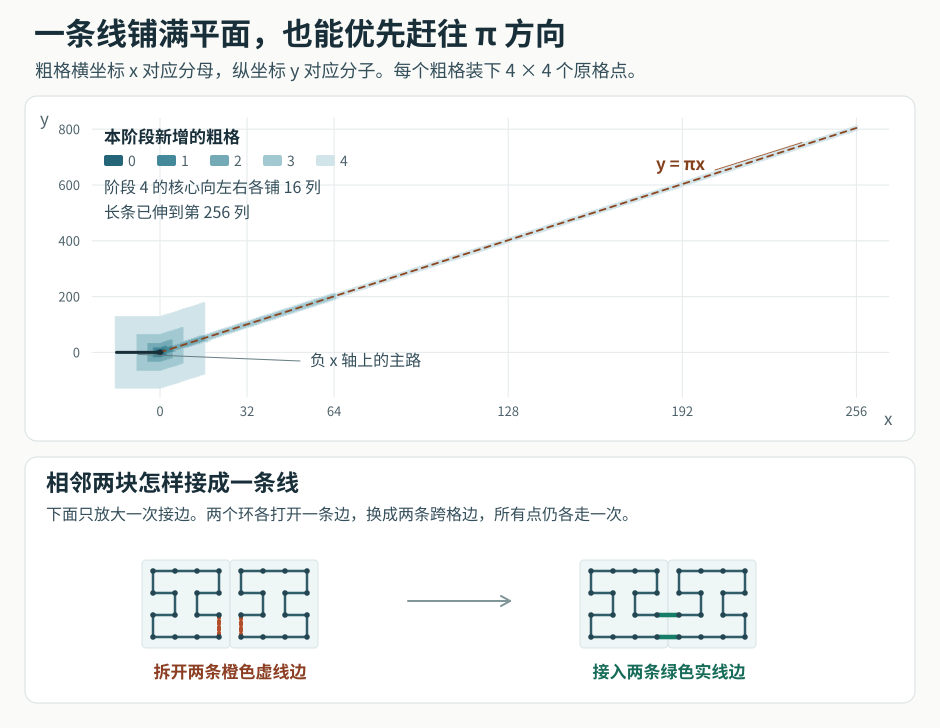

# 一条永不重访的线，同时铺满整数平面并沿 π 快速向前

设 \(F(0)=(0,0)\)。时钟 \(t\) 每增加一，\(F(t)=(q,p)\) 在整数方格上水平或竖直移动一格。此前已构造一条允许重访的路线，在 \(O(H^2)\) 步内覆盖高度不超过 \(H\) 的格点，并在 \(O(N)\) 步内经过分母到 \(N\) 的全部最近 \(\pi\) 标记。本次解决原任务书里附加“永不重访”后的问题。[前次构造](RATIONAL-WALKS.zh.md) · [原问题](UNIT-STEP-GEOMETRY-TASKS.zh.md)

**定理。** 存在单条双射 \(F:\mathbb N_0\to\mathbb Z^2\)，从原点出发，连续两点的曼哈顿距离为 1。对每个正整数 \(H,N\)，它在至多 \(4608H^2\) 步内走完 \([-H,H]^2\) 的所有格点，并在至多 \(4608N\) 步内走完
\[
z_q=(q,\lfloor\pi q+1/2\rfloor),\qquad 1\le q\le N.
\]
系数 4608 只是下面构造的方便估计。沿路遇到 \(q>0,\ \gcd(q,|p|)=1\) 才输出 \(p/q\)，每个有理数就恰好输出一次。这里的线在整数时刻精确覆盖离散平面。连接相邻位置的线段只沿方格边走。

## 先规定到每个时刻应铺完哪一片

把平面划成互不重叠的 \(4\times4\) 小块。粗坐标 \((x,y)\) 的块包含细格点
\[
(q,p)=(4x+i-3,\ 4y+j),\qquad 0\le i,j\le3.
\]
横向平移三个单位使第一步从细格原点开始。对所有整数 \(x\)，设 \(f(x)=\lfloor\pi x\rfloor\) 当 \(x\ge0\)，其余取 0。相邻两列的 \(f\) 相差至多 4。

阶段 \(k=0,1,\ldots\) 取 \(h=2^k,\ L=4^k=h^2\)。先画粗格区域 \(G_k\)。它的横坐标从 \(-h\) 到 \(L\)，每列为以 \(f(x)\) 为中心的闭整数区间。当 \(-h\le x\le h\) 时半宽取 \(8h\)，其后半宽取 8。这样中部容纳整个半径 \(h\) 的方框，窄带可延伸到第 \(L\) 列。

令 \(D_0=G_0\)。从第二阶段起，把旧区域 \(D_{k-1}\) 向八个方向扩一格，再和 \(G_k\) 取并，得到 \(D_k\)。记 \(D_{-1}=\varnothing\)。第 \(k\) 段路径只走新增的小块 \(S_k=D_k\setminus D_{k-1}\)。以下三个事实保证这些集合可以使用。

1. **每个新层 \(S_k\) 上下左右连通。** 归纳可见 \(D_k\) 有连续的非空列，每列为一个整数区间，相邻列有公共高度，每列含 \(f(x)\)。向八邻扩张后，各列由至多三条原列的加厚区间组成，仍是单个区间。与 \(G_k\) 的公共列上两者都含 \(f(x)\)；若是扩张新增的端列，紧邻的旧列中心离本列 \(f(x)\) 至多 4，落在 \(G_k\) 的半宽内，两个区间仍相交。原区域最左端为 \(-2^{k-1}\)，最右端为 \(4^{k-1}\)，各扩一格后仍在新区域的横坐标范围内。新区域包含 \(G_k\)，其相邻列的区间相交。
   
   具体看旧区域外侧一格厚的边。若旧区域两相邻列顶端为 \(a,b\)，则高度 \(\max(a,b)+1\) 位于两列的上侧外边中。这使所有上侧外边连通；底部同理。两端外加的整列把上下连起来，故八邻扩张形成的外边本身是四邻连通的。任一新增点都能在连通的 \(D_k\) 中走向旧区域；第一次进入旧区域前，已从新增点走到这条外边，全段都在 \(S_k\) 内。首阶段的连通性直接来自 \(G_0\)。
2. **阶段面积有统一界。** 展开递推，\(D_k\) 是各 \(G_j\) 向八邻扩张 \(s=k-j\) 次的并。令 \(a=2^j\)。第 \(j\) 阶段中部扩张后至多占 \((2a+2s+1)(20a+2s+1)\) 个位置。窄带扩张后至多占 \((a^2+2s+1)(17+10s)\) 个位置，因为在给定新列中，原中心的横向来源相隔至多 \(2s\)，其高度相差至多 \(8s\)，另加上下各 \(s\)。两项之和至多 \(97a^2(s+1)^2\)。利用 \(\sum_{s\ge0}(s+1)^2/4^s=80/27\)，有 \(|D_k|\le288\cdot4^k\)。
3. **旧层和新层有确定的接头。** 取负横轴 \(y=0,\ x\le0\) 作主线。\(D_k\) 与这条轴的交集恰为 \(x=-h,\ldots,0\)。所以 \(S_k\) 在轴上是一段尚未走过的连续格子，按 \(x\) 递减方向排列。前一段的最后一个小块紧邻后一段的第一个小块。

## 怎样把许多块接成一条线

在每层有限连通图上，以主线的各块为根做多源广度优先搜索。每个非主线小块指定唯一父块，得到附在主线各块上的若干棵树。取邻居的顺序固定为东、北、西、南，主线根按从东到西入队，这也给出了可重复的具体顺序。

普通小块内部先画经过 16 个点的闭环，主线块画经过 16 个点的开路径。下面用 \(ij\) 表示块内点 \((i,j)\)，主线从右下角 \(30\) 进入，从左下角 \(00\) 离开。

| 块类型 | 逐点顺序 |
|---|---|
| 普通闭环 | 00 01 11 12 02 03 13 23 33 32 22 21 31 30 20 10 00 |
| 主线开路径 | 30 31 32 33 23 22 12 13 03 02 01 11 21 20 10 00 |

在每条树边上，取父子两块相对边界上一对平行单位边，删去这两边，改接两条横跨边界的单位边。具体选每侧从下往上或从左往右数的第一条。普通块的四个此类接口都在环上。主线块有上下接口和东接口；西面若存在下一主线块，就直接将两端点相连，若该层已经到达最西列，西面没有本层块。首层主线最东块可以用东接口接分支，以后的层其最东主线块的东邻属于旧层。

把一个环接到一条路径上，相当于沿切开的环增走其中每个点，再回到原路径的下一点。因此原路径的两个端点保留，新的每个点恰好出现一次。两个环同样可以接为一个环。每个块的每一侧只对应一个可能的树邻居，不会两次删同一条边。沿森林依次拼接，再连接相邻主线块的端点，就得到遍历本层所有细点的一条开路径。相邻层的端口也恰好相距一格。不同层的小块互不相交，而且每个粗格最终都进入扩大的中部方框。由此得到从原点出发的无限自避路径，它覆盖整个 \(\mathbb Z^2\)。有限生成树用于网格覆盖的经典构造见 Gabriely 与 Rimon；这里的两种同时抵达时限由上面的无限分层建立。[Spanning-tree based coverage of continuous areas by a mobile robot](https://www.cs.cmu.edu/~motionplanning/papers/sbp_papers/integrated4/gabriely_spanning.pdf)

## 两个截止时间和必须付出的绕行

第 \(k\) 阶段的最后时刻恰为 \(16|D_k|-1\)，因为脚下从时刻 0 起始终是新点。此时已经走完半径 \(4h\) 的整个细格方框。确实，那里两条粗坐标绝对值都不超过 \(h\)，而 \(|f(x)|\le4h\)，故均在中部以内。对 \(1\le q\le4L\)，取 \(p=\lfloor\pi q+1/2\rfloor\) 时，其粗列 \(x=\lfloor(q+3)/4\rfloor\) 满足 \(0\le x\le L\)。写 \(p=4y+j,\ q=4x+i-3\)，则
\[
|y-f(x)|\le(3\pi+3+1/2)/4+1<5.
\]
全部标记都落在半宽至少为 8 的区域内。取最早满足 \(4h\ge H\) 或 \(4L\ge N\) 的阶段，分别有 \(4^k\le H^2\) 或 \(4^k\le N\)。阶段面积界便给出开头的两条不等式。方框内有 \((2H+1)^2\) 个位置，而第 \(N\) 个标记即使直达也要 \(N+\lfloor\pi N+1/2\rfloor\) 步，两个阶数都不可降低。

还能解释为什么兼顾全局时，线性时间的常数要比沿着斜线直达的大。对任一从原点出发、走遍所有最简代表和全部标记的单位步路线，设 \(T(N)\) 为走完前 \(N\) 个标记的最早时刻，允许路线自交或重访。则
\[
\limsup_{N\to\infty}T(N)/N\ \ge\ 3(1+\pi).
\]
取先后任意晚的某次访问 \((1,-j)\)，这些点全是最简代表。令 \(m\) 是此时已访问标记的最大分母，随所取时刻趋于无穷而趋于无穷。之前访问过 \(z_m\)，之后还得去 \(z_{m+1}\)。原点到 \(z_m\)、再到 \((1,-j)\)、再到 \(z_{m+1}\) 的三段曼哈顿距离合计至少 \(3(1+\pi)m+2j-O(1)\)。前 \(m+1\) 项的完成时刻至少这么大。除以 \(m+1\) 即得。进一步把方框内必须付出的步数计入，可得两个常数间的约束，同时求出允许重访时线性常数的下确界。[时间常数的证明](TIMING-CONSTANTS.zh.md)

若再要求“任意连续 \(d\) 步的首尾距离总不超过 \(K\sqrt d\)”来描述局部紧密地铺平面，那么从原点抵达横坐标 \(N\) 至少要 \(N^2/K^2\) 步。这说明本定理中那条远伸的窄带承担了一个必要功能。几何构造对其他固定斜率同样可用，只须按斜率调整列间高度差和带宽。作为对照，一条按九宫格递归铺开的路线可以达到统一的平方根位移上界。[局部铺法与反向编号](PEANO-LATTICE-CLOCK.zh.md)。本定理本身给不出 \(\inf_{q\ge1}q\|q\pi\|\) 的取值。

## 有限实测和证明的边界

运行标准库命令 **python3 verify_hamilton_cover.py --max-stage 4**。程序使用 Machin 公式的有理交错上下界，直到每一个取整的两端都给出同一个整数。它沿实际路径检查每步距离、每个细点是否重复，并分别查找方框和全部标记的最晚到达时刻。表中时刻从原点的 0 算起。

| 阶段 | 已访问不同格点 | 全部走完的方框半径 | 方框最后到达时刻 | 已全数命中的分母上限 | 标记最后到达时刻 |
|---:|---:|---:|---:|---:|---:|
| 0 | 816 | 4 | 694 | 4 | 268 |
| 1 | 3,184 | 8 | 2,626 | 16 | 1,380 |
| 2 | 12,688 | 16 | 12,212 | 64 | 6,652 |
| 3 | 51,392 | 32 | 50,444 | 256 | 27,459 |
| 4 | 207,488 | 64 | 205,596 | 1,024 | 111,128 |

[逐步路径验证器](verify_hamilton_cover.py)。所有尺度的结论来自连通性、接缝和面积证明。这个脚本只复查表内样本，计算机的运行时间也与行走的格步数分别计量。

同期读回了[原生 BBP 接力](SPARSE-EXCEPTION-RELAY-RESULTS.zh.md)。其单点二进结果和本篇的全格点覆盖解决不同量词。另见[带进位的 BBP 平移](BBP-TRANSLATION-BAND.zh.md)、[最简代表覆盖的费用改进](MATCHED-STRIP-ROUTES.zh.md)及[一条固定路线逼近各方框最短路](ONE-WALK-ALL-HEIGHTS.zh.md)。
