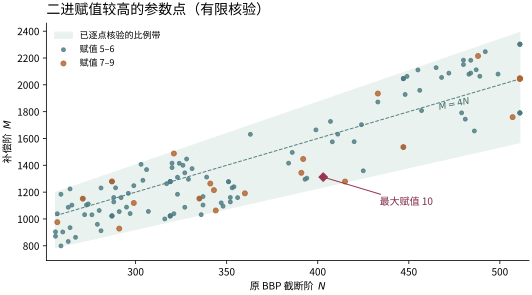

# BBP 的潜在例外有多少？同一三中心族的费用又能提高多少？

接续[原 Yohaku 世界的同版验收记录](https://github.com/epsilon-lain/yohaku/blob/4db90bb1a343efff45e5e9c25aa2ef8310ffd2e7/research/pi-equivalence-native-2026-11-18/MIXED-RANK-CARRY-RESULTS.zh.md)。以下推导与复算是基于该提交的独立续研。原生任务编号和运行回执属于所链接的上一轮。

## B 线：每次把截断尺度翻倍，只剩有界个候选

记 $N$ 为 BBP 截断阶，$M$ 为补偿次数，$X_{N,M}$ 为[固定的有限积分补偿](RANK-ODD-PRIMES-RESULTS.zh.md)所得有理数。$Q_{N,M}$ 是正既约分母，$T_{N,M}=Q_{N,M}^2|\pi-X_{N,M}|$。寻找这族中的好逼近时，剩余的斜率 $M/N$ 全部位于 $I=[3.07,4.68]$。

**计数定理。** 存在与 $B$ 无关的常数 $C$，使对所有 $B\ge2$ 有
$$
 \#\{(N,M):1\le N\le B,\ M/N\in I,\ T_{N,M}\le e^{5N}\}
 \le C\log(2B).
$$
更强地，在每个 $R\le N\le2R$ 的斜率带内，候选点对的总数为 $O(1)$。这是同时对两个自由整数的计数。若选择任意序列 $M=4N+o(N)$，且其中有无穷多个例外，那么相邻例外的 $N$ 最终必须至少按某个大于 1 的固定倍率增长。[二维间距定理](BBP-DYADIC-SPACING.zh.md)

证明研究的是 $Y_{N,M}=16^NX_{N,M}$ 的二进赋值。要使分母丢掉线性数量的因子 2，$Y$ 必须被很高的 2 的幂整除。如果附近两个点都如此，缩放后两个分数之差也有很高的二进赋值。核的四个极点满足同一个八次恒等式，因而这个差可以准确化成一个二次多项式在 $(1+\sqrt2)^{\min(M,M')}$ 处的值，乘上明确的有理缩放及一个二进单位。两个点越近，二次多项式系数的高度越低。实共轭的积分比较排除多项式恒等于零的情形；Yu 关于二进对数的定理则限制一个低高度多项式在这个单位幂处能接近零到什么程度。由此，两处线性规模的二进损失在参数平面里必须相隔正比例的距离。最后用上一轮的奇分母下界把间距转换为 $T$ 的结论。[Yu 定理 2，原文第 339 页](https://matwbn.icm.edu.pl/ksiazki/aa/aa89/aa8944.pdf#page=3)

一个很宽松的有效常数说明这里的“有界”可以落实为整数：在 $R\ge10^{110}$、$R\le N\le2R$、$3R\le M\le10R$ 的矩形中，满足 $v_2(Y)\ge R/100$ 的点少于 $10^{203}$ 个。这个上界用于核验定理的量词，未给出可用的穷尽搜索截止处。[数值常数及复算](BBP-SPACING-CONSTANT.zh.md)

## 哪些单独阶数、哪些整条斜率已被排除

* **斜率 4 的可指定无限族。** 对每个固定正奇数 $A$，取 $N=A2^s-1$、$s\to\infty$。沿每一种 $M=4N+o(N)$，最终都有 $v_2(Q)=4N+O_A(\log N)$。证明针对原判据可能发生并项相消的情形，对完整二进块求和，给出精确赋值公式。它将原报告的 $A=2^u-1$ 扩展为任意固定奇部。[二进整块定理及边界](BBP-DYADIC-BLOCKS.zh.md)
* **斜率轴上的几何结论。** 除一个 Hausdorff 维数为零的斜率集以外，对每个 $t\in I$、每个 $\delta>0$，在 $|M-tN|=O(N^{1-\delta})$ 的整条带中，归一化误差最终有统一正指数。证明把每层的至多常数个异常点投影到斜率轴上：半径 $2^{-j\delta}$ 的覆盖区间，其直径的任意正次幂都可求和。这个结论本身不确定具体斜率 $4$ 是否属于零维例外集。[覆盖证明与量词](BBP-EXCEPTIONAL-SLOPES.zh.md)
* **奇分母的典型大小。** 在 $M/N\to t\in I$ 附近的增长横向窗口，$\log Q^{\rm odd}_{N,M}/N$ 依相对计数密度趋于 $6+5t/4$。沿每一条固定 $M=tN+O(1)$，对 $N$ 也成立，偏离集合的上 Banach 密度为零。这里用的是五个位置上余数不能一起消失的行列式，与二进对数间距相互独立。特别在 $M=4N$ 上，典型的奇分母指数为 $11$，合并二进结果，归一化误差的指数在密度意义下趋于 $20.65991305\ldots$。[横向的进位素数](BBP-CARRY-DENSITY.zh.md) · [固定斜率](BBP-BEATTY-CARRY.zh.md)

**最后的缺口。** $O(\log B)$ 仍容许无限多个孤立的分数。若在 $M/N\to4$ 的某个子序列上 $T$ 有界，按 OpenAI 预印本给出的 $\mu(\pi)=2$ 及此前的分母质量恒等式，二进分母的对数与保留下来的进位奇素数对数和，相加再除以 $N$，必须趋于 $0.0808022\ldots$。现有估计仍容许归一化误差次指数地趋于零。判定这些孤立候选是否存在，以及寻找适用于全部有理分母的统一常数，是两个仍未解决的问题。[必要条件的推导](BBP-EXCEPTIONAL-SLOPES.zh.md) · [预印本主定理](https://github.com/openai/math/blob/4eaee87548250b2682affda7d05d947c05554bae/preprints/The-irrationality-exponent-of-pi-is-2-September-24-2026/build/main.tex)

## A 线：同一真实列集的费用上下界

在原三中心族的固定选列上，设 $J_H$ 为两个矩阵都非奇异的完整指标基的最小归一化费用，$H$ 为高度。按第二横向次数 $b$ 分层，原始行和原始选列每个阈值以上的个数恰好相等；两侧都要独立，因而每个完整共同基在该层必须恰取规定数量的指标。两侧矩阵都随即分解成方形对角块，逐层可独立选择并拼接。数清每层最便宜的整数指标给出下界，另构造明确的一组真实共同基给出上界。令 $\lambda=\log(2)/2$，则
$$
 \tfrac18+\tfrac12\sqrt{3\lambda/2}
 \le\liminf J_H\le\limsup J_H\le(2+\lambda)/4 .
$$
两端约为 $0.48550672$ 和 $0.58664340$。新的下界比对同一指标地集把纯计数积分做到饱和所得的 $0.47919761\ldots$ 高出 $0.006309$ 以上。与上轮只在短费用区间上获得的 $3.3\times10^{-8}$ 有不同的积分终点。扣除真实行列的平均横向费用 $3/8$ 后，解析及算术误差之前的裕量至多为 $0.211644$。在这个特定参数族中，若原样代入既有解析预算，仅 $100K/w_0$ 一项就等于 $300$。因此继续加严共同基计数，无法单独弥合这里的原预算。解析损失的实际大小和其他参数选择仍可单独研究。[完整共同基与费用](COMMON-SLICES.zh.md) · [有限高度的 Taylor 前缀秩分解](C-PLANE-SPLIT.zh.md)

## 有限核对与复算入口

对 $256\le N\le511$、$3.07N\le M\le4.68N$ 的全部 158,070 对整数，逐项核对 $v_2(Y)$。最大值为 $10$，仅在 $(403,1312)$ 取得，无一例达到 $N/8$。计算将阶乘分离成 2 的幂和奇单位，在足够多的模 2 幂位数上做精确整数运算；凡结果为零模所用精度便中止报告。选定的九个端点或中线样本另外直接重构整个有理数。这些有限数据核对实现，无穷结论依赖上述证明。[精确核验脚本](verify_bbp_residual_band.py)

在本目录以 Python 3 运行相应脚本即可，不需要第三方库。

| 复算脚本 | 对象 |
| --- | --- |
| [二维差](verify_bbp_dyadic_spacing.py) · [显式常数](verify_bbp_spacing_constants.py) | 四极点有限差、二次多项式、清分母及 Yu 参数 |
| [二进块](verify_bbp_dyadic_blocks.py) · [整个有限窗口](verify_bbp_residual_band.py) | Pell 系数、进位、精确赋值、直接有理数对照 |
| [横向余数](verify_bbp_carry_density.py) · [移动余数](verify_bbp_diagonal_carry.py) | 五阶子式、原始分数的逐素数消去 |
| [完整共同基](verify_common_slices.py) · [Taylor 分层](verify_c_plane.py) | 72 阶顶层证书、低成本前缀、分层上下界 |

本轮的研究经验是分清“排掉一个参数点”和“限制两个候选能靠多近”。做两点之差能消掉共同的 $\pi$，让可计算的代数单位接手间距问题；单个候选的临界常数仍需要额外的非消去机制。
